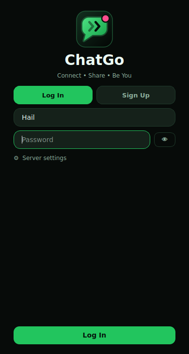
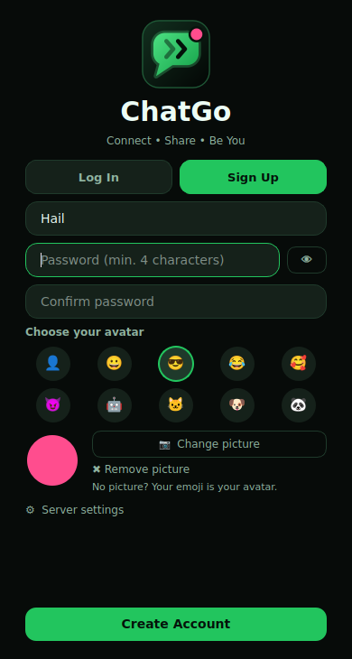

<p align="center">
  
</p>

# ChatGo

A local multi-user chat app made with **Python**, **PyQt6**, and **sockets**.  
Final project for **OOP 2** (BS Computer Engineering) by **Group 2**.

| Log in | Sign up | Chat list |
| :---: | :---: | :---: |
|  |  |  |

---

## Features

- **Authentication:** Login and sign up with a username and password (passwords saved as salted hashes).
- **Custom Profiles:** Display name and avatar support—pick an emoji avatar and optionally upload a profile picture.
- **Rich Messaging:** Chat threads display the username, avatar, and date/time of every message.
- **Character Limit:** 300-character limit per message with a live counter.
- **Emoji Support:** Emoji picker (`😊` button).
- **Actions:** Send button (Enter key shortcut) and an **Edit last message** button.
- **Local Multi-User Mode:** Multiple users can chat simultaneously through the server.
- **Group & Private Chat:** Supports group chats, direct private messages, unread counters, online status, and saved chat history.
- **Theme & Layout:** Green and black theme with a pink accent, custom logo, and a compact phone-sized window (390 × 844).

---

## How It Works

```text
+-------------------+                          +-----------+      +---------------+
| Client (main.py)  | <--- text messages --->  | server.py | ---> |  users.json   |
| Client (main.py)  | <---  over TCP/IP  --->  |           |      | history.json  |
+-------------------+                          +-----------+      +---------------+
