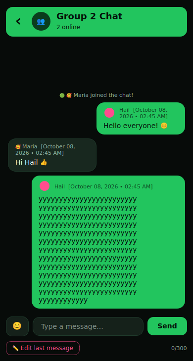
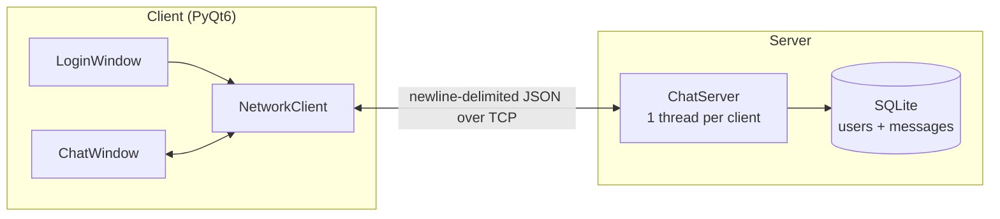

<p align="center"></p>

# ChatGo — Local Multi-User Chat


A desktop chat application built with **Python**, **PyQt6** and **TCP sockets**, designed
as a phone-sized app (390 × 844). Several users can sign up, log in at the same time, chat in a
shared room, send private messages, use emojis, and edit their last message.
Developed by **Group 2** as the OOP 2 final project (BS Computer Engineering).

| Log in | Sign up | Chat list | Conversation |
|:--:|:--:|:--:|:--:|
|  |  |  |  |

## Features

- **Login** — username and password authentication (**Log In** / **Sign Up**); passwords are
  stored only as salted PBKDF2 hashes
- **Username & avatar** — display name, emoji avatar, and an **optional profile picture**
  (any PNG/JPG, cropped to a circle)
- **Chat thread** — avatar, username, date and time stamp, message:
  `😎 Hail [September 12, 2026 • 08:45 AM]: Hello!`
- **Message length limit** — maximum **300 characters** (live `0/300` counter; the server
  enforces it too)
- **Emoji support** — 😊 picker with tabs (faces, hands, hearts, animals, objects)
- **UI** — green & black theme with a rose complementary accent, custom logo, Send button
  (Enter works too) and an optional **Edit last message** feature (shows *(edited)*)
- **Local multi-user mode** — `python run_local.py` starts the server and several phone
  windows side by side on one computer
- **General room + private messages**, unread badges, online dots, search, and saved history
  (SQLite)

## Architecture



**Message flow:** the client sends `{"type":"message","to":null,"text":"Hi"}` →
the server saves it, adds an id and timestamp → it is delivered to everyone (public) or to
sender + recipient only (DM) → each `ChatWindow` stores it and draws a bubble.

### Project structure

```
chatgo/
├── common/protocol.py       # packet format, constants, timestamp helper (shared)
├── server/
│   ├── server.py            # sockets, threads, routing, broadcast
│   └── database.py          # SQLite: accounts, password hashing, history
├── client/
│   ├── app.py               # entry: login -> chat window
│   ├── login_window.py      # Log In / Sign Up screen
│   ├── chat_window.py       # chat list page + conversation page, edit logic
│   ├── widgets.py           # LogoWidget, AvatarWidget, ConversationTile, MessageBubble, EmojiPicker
│   ├── network.py           # NetworkClient (socket + reader thread -> Qt signals)
│   ├── phone.py             # standard phone window size and placement
│   ├── images.py            # profile picture <-> base64 helpers
│   ├── emoji_data.py        # emoji categories
│   └── theme.py             # colours + stylesheet
├── tests/test_server.py     # integration tests (real sockets)
├── run_server.py            # start the server
├── run_client.py            # start one client
└── run_local.py             # server + several clients on one computer
```

OOP concepts used: classes with single responsibilities (`ChatServer`, `Session`, `Database`,
`NetworkClient`), inheritance from Qt classes (`QDialog`, `QFrame`, `QWidget`), encapsulation
(each widget owns its layout), signals/slots (observer pattern), and separation of GUI,
networking and storage.

## Getting started

Requires **Python 3.10+**.

```bash
git clone https://github.com/<your-username>/chatgo.git
cd chatgo
python -m venv .venv
.venv\Scripts\activate          # Windows   (macOS/Linux: source .venv/bin/activate)
pip install -r requirements.txt
```

**1. Start the server** (one computer):
```bash
python run_server.py            # options: --host 0.0.0.0 --port 5555 --db chatgo.db
```

**2. Start a client** (as many windows/computers as you like):
```bash
python run_client.py
```
Choose **Sign Up** the first time (username, password, avatar, optional picture), then
**Log In** afterwards. Under **⚙ Server settings** use `127.0.0.1` if the server is on the same
computer, otherwise the server computer's LAN IP (find it with `ipconfig` / `ifconfig`).
Allow port **5555** through the firewall.

**Local multi-user mode** (everything on one computer, one command):
```bash
python run_local.py             # server + 2 phone windows;  --clients 3 for three
```
Sign up a different user in each window and chat between them.

> GitHub stores the code but does not *run* it. To let classmates connect from anywhere, run
> the server on one machine on the same Wi-Fi/LAN, or on a small cloud host.

## Tests

```bash
pip install -r requirements-dev.txt
python -m pytest
```
Covers sign-up/login rules, wrong and duplicate logins, public broadcast, private DMs, the
300-character limit, editing rules, profile pictures and history.

## Protocol

One JSON object per line. See [`common/protocol.py`](common/protocol.py) for the full list.

| Direction | `type` | Purpose |
|---|---|---|
| C → S | `register` / `login` / `message` / `edit` | create account, authenticate, send, edit own message |
| S → C | `login_ok` / `login_error` | result + user list + history |
| S → C | `message` / `edited` | new or updated message |
| S → C | `presence` / `system` | online status, join/leave notices |

## Known limitations / roadmap

- Traffic is not encrypted (use only on trusted networks; add TLS for real deployments)
- Profile pictures are set when you sign up (changing one later is on the roadmap)
- Ideas: typing indicator, delete message, change picture, group rooms

## Team

Group 2 — BSCpE · OOP 2 · <add member names here>

## License

MIT — see [LICENSE](LICENSE).
